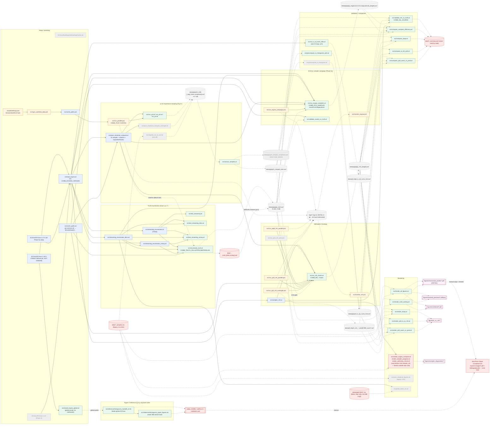

# Current architecture (as of 2026-11-20, commit b4d4b20)

Low-level file-flow map of the repo as it actually works today. Built from
`inventory.md` (one record per tracked file). Data and log nodes are grouped
by filename family; all of them live in the main checkout via
`src/comb_paths.wl` / `src/comb_paths.ps1`.

Legend: solid arrow = `Get` / dot-source / launches; dashed arrow = writes or
reads a data/figure family; red node = broken, orphan or manual step;
grey node = superseded / dead.

## What a cloner hits today

1. **No data.** About 9 GB lives only on the Ryzen PC; the GitHub clone has
   none of it except the 104 MB Mac-only `.mx` files. Everything has to be
   regenerated, which takes days (q=10 IS) plus 17 h for (4,5) truth.
2. **No single entry point.** About 15 scripts run in an order kept in
   `AGENTS.md` and people's heads. Configuration is about 30 `COMB_*`
   environment variables. Parallel runs need Windows PowerShell.
3. **Manual steps in the chain.** McKay truth must be renamed by hand from
   `_truth_mckay.wxf` to `_truth.wxf`. The `.tex` needs figures copied by
   hand into an `Images/` folder that does not exist, and their names do
   not match what the renderers write. The Fig 2 notebooks write to their
   own cwd and need the global paclet.
4. **Two worlds.** Fig 2 comes from interactive notebooks; the rest comes
   from scripts. The ECGrav pin (1.18) differs from the version that made
   the data (1.17), and the WXF files do not record which version made them.
5. **Clutter.** Superseded or one-off files sit beside production ones:
   `run_q10_mh_pilot`, `precompute_is_histogram`, `migrate_csv_to_wxf`,
   `pure_simplicial_compute_overnight`, `probe_betre_mx`,
   `pure_simplicial_figures.nb`, three diagnostic renders, `archive/`, the
   tracked logs, and dev-only worktree sync tooling.
6. **Dead outputs.** Every `*_summary.wxf` and `merged_complexes` is written
   and never read; L1 tables are transcribed into the docs by hand.

See `inventory.md` for every per-file issue, plus the critic's
cross-checks.
