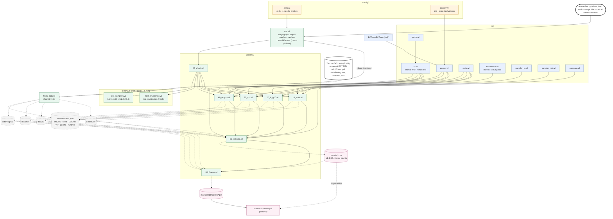

# Ideal architecture (target for public release)

The goal: an outside researcher clones from GitHub, installs Wolfram 15+,
and with one command per goal either **downloads** the published data and
rebuilds every figure in minutes, or **regenerates** everything from
scratch. Nothing needs Windows, PowerShell, git worktrees, a global paclet,
manual renames or hand-copied figures.

## Target layout

```
README.md                  quickstart: 3 commands
config/
  cells.wl                 THE config: cells, N, seeds, targets, profiles quick|paper
  ecgrav.wl                ECGrav pin (one place) + expected version check
lib/                       pure libraries, no side effects on Get
  paths.wl                 repo-relative data/ figures/ (COMB_ROOT override only)
  ecgrav.wl                loader (was load_ecgrav.wl) + subkernel loader
  io.wl                    exportWxfAtomic, manifest (sha256, ECGrav ver, seed, git sha)
  stats.wl                 statsFor + 12-stat schema (split out of pure_simplicial_compute)
  enumerate.wl             cheap + McKay (BLISS primitives inside); auto-pick by cell
  sampler_is.wl            q=10 IS (from pure_simplicial_compute) with chunking + merge
  sampler_mh.wl            unchanged algorithm
  compare.wl               L1 / ESS / histogram helpers shared by all comparisons
pipeline/                  one script per stage, idempotent, skip-if-manifest-matches
  00_check.wl              Wolfram version, ECGrav pin, smoke tests
  10_truth.wl              → data/truth/p{p}q{q}.wxf   (writes final name directly)
  20_is_q10.wl             → data/is/p{p}q10_{stats}.wxf (chunks merged in-stage)
  30_mh.wl                 → data/mh/p{p}q{q}_{target}[_{tag}].wxf
  40_ecgrav.wl             → data/ecgrav/p{p}q{q}_{sampler}_{target}.wxf
  50_validate.wl           → results/*.csv  (ALL L1/ESS/3-way tables; figures + paper read these)
  60_figures.wl            → manuscript/figures/*.pdf (names = what the .tex includes)
run.wl                     orchestrator: wolframscript -file run.wl <stage|all> [--profile quick|paper] [--from-download]
fetch_data.wl              download Zenodo DOI tarball(s), verify sha256 → data/
tests/                     test_enumerate.wl (iso-count gates for all 9 cells), test_samplers.wl, run_tests.wl
manuscript/                main.tex, bibliography.bib, figures/ (generated, gitignored), latexmk
notebooks/                 fig2_reference.nb rewritten to call lib/ + write via paths.wl (optional, interactive)
ECGrav/ECGrav-<pin>/       ONLY the pinned snapshot (older ones in git history / tags)
tools/dev/                 sync_worktree_data, monitors, Claude hooks (not on the reproduction path)
```

## Flow



## Three ways to use it

| Goal | Command | Time |
|---|---|---|
| Rebuild figures and tables from published data | `wolframscript -file run.wl all --from-download` | minutes |
| Check the code on a laptop | `wolframscript -file run.wl all --profile quick` | about 10 min |
| Full reproduction | `wolframscript -file run.wl all --profile paper` | days; stages resumable |

## Current → ideal mapping

| Current file(s) | Ideal home | Action |
|---|---|---|
| `src/comb_paths.wl`, `comb_paths.ps1` | `lib/paths.wl` | drop the worktree/git logic from the public path; repo-relative default |
| `src/load_ecgrav.wl`, `install_ecgrav_global.wl` | `lib/ecgrav.wl` + `config/ecgrav.wl` | one pin; record version in every manifest; the global install becomes optional (notebooks only) |
| `ECGrav/ECGrav-1.0.0`, `-1.17.0`, `BuildingAndInstallingPaclets.nb` | git tag / history | keep only the pin. **Validate 1.18 first, or pin 1.17, which made the data** |
| `streaming_enumerator{,_bliss,_mckay}.wl` | `lib/enumerate.wl` | auto-pick McKay for p=4 q≥5; BLISS stays as an internal primitive |
| `enumerate_truth.wl` | `pipeline/10_truth.wl` | write the final `truth/p{p}q{q}.wxf` directly (no manual rename); gates for all 9 cells; fix the hardcoded `ecGravVersion="1.0.0"` |
| `test_streaming*.wl` | `tests/test_enumerate.wl` | merge |
| `pure_simplicial_compute.wl` | `lib/sampler_is.wl` + `lib/stats.wl` + `lib/io.wl` | split; other scripts stop Block-Getting it just to borrow `statsFor`/`exportWxfAtomic` |
| `run_p{2,3,4}.wl`, `run_parallel.ps1`, `pure_simplicial_compute_overnight.wl`, `concat_samples.wl` | `pipeline/20_is_q10.wl` | p list from config, parallel through LaunchKernels, merge built in |
| `migrate_csv_to_wxf.wl`, `precompute_is_histogram.wl`, `run_q10_mh_pilot.ps1`, `probe_betre_mx.wl`, `pure_simplicial_figures.nb`, legacy `*_samples.csv`, Betre `.mx` | delete (history keeps them) | superseded or one-off |
| `run_mh_chains.wl` + 3 `.ps1` launchers | `pipeline/30_mh.wl` | chains, seeds and warm starts declared in `cells.wl`; covers all 9 truth cells plus q=10 |
| `run_ecgrav_samplers.wl`, `run_ecgrav_campaign.ps1`, `validate_counts_vs_truth.wl` | `pipeline/40_ecgrav.wl` (+ count check in 50) | — |
| `validate_mh_vs_truth`, `compare_samplers_efficiency`, `precompute_is_histograms_q10`, `run_is_at_truth_cells`, `compare_3way`, `compare_is_mh_q10`, `compare_q10_warm_vs_prod` | `pipeline/50_validate.wl` + `lib/compare.wl` | one results table; outputs are actually read (by figures and the paper) |
| `render_*.wl` (8), `src/reference/*.nb` | `pipeline/60_figures.wl` (+ optional `notebooks/`) | filenames match the `\includegraphics` names; Fig 2 moves from notebooks into the script |
| `docs/Pure Clique Complexes.tex` | `manuscript/main.tex` + `bibliography.bib` | fix the Betti2 and num1V copy errors the inventory found |
| `monitor_*.ps1`, `sync_worktree_data.ps1`, `.claude/settings.json` | `tools/dev/` | not on the reproduction path |
| `archive/`, tracked `logs/`, `docs/handoff/*.jsonl` | removed from the tree (tag `pre-cleanup`) | logs gitignored |

## Suggested order of work

1. Decide the ECGrav pin: validate 1.18 against the truth grid, or pin 1.17.
2. Publish the small, high-value data now (truth, ecgexact, MH, IS
   histograms) and write `fetch_data.wl`. This gives cloners a usable repo
   immediately.
3. Make `config/cells.wl` and `run.wl` wrap the **existing** scripts. This
   adds the single entry point without moving code yet.
4. Split the libs (`stats`, `io`, `sampler_is`) and fold the scripts into
   the pipeline stages one at a time, checking each against `results/`.
5. Make the figure names match the manuscript, then delete the dead files
   and tag the old tree.
