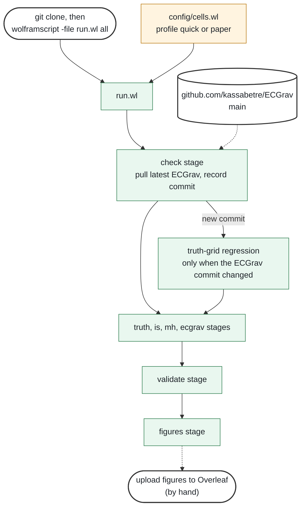
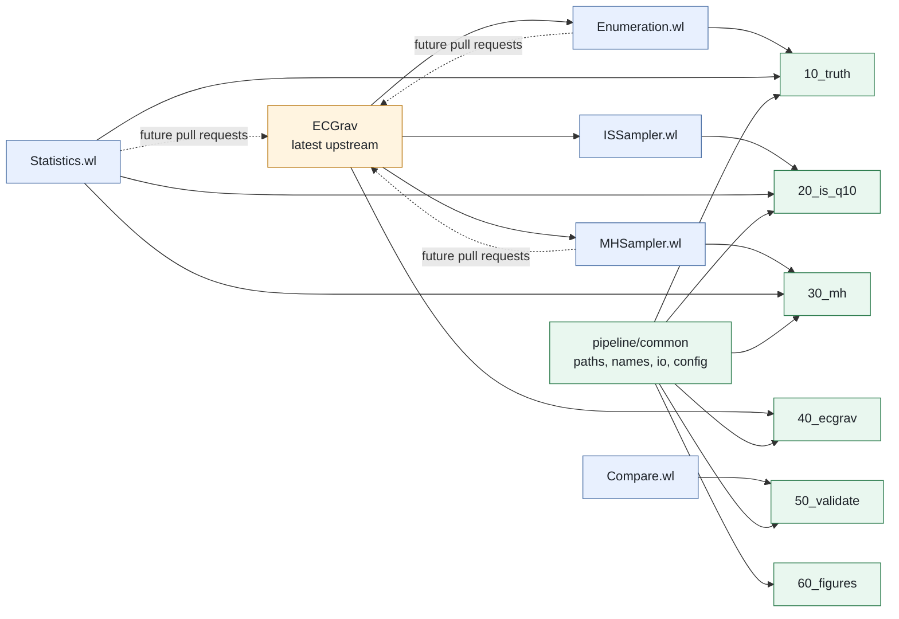
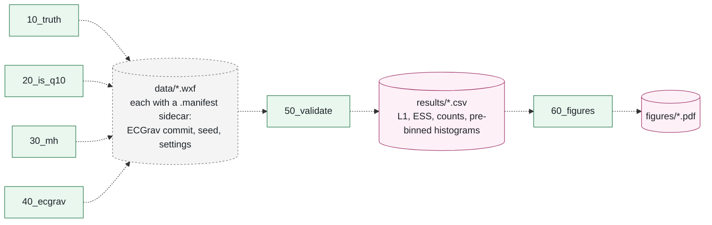

# Ideal architecture

Revised 2026-11-20 for the project direction:

- always run on the **latest upstream ECGrav** (Dr. Betre's main branch);
- the algorithms here should eventually be **merged into ECGrav**;
- **data is not published**, so a reproducer regenerates it;
- LaTeX lives on **Overleaf**, and local `.tex` files are reference only.

The goal: an outside researcher clones the repo, installs Wolfram 15+, and
regenerates the data and figures with one command. We keep working the way
we do now: worktrees, one shared data store, long parallel runs on the
Ryzen.

## Target layout

```
README.md                    quickstart
run.wl                       orchestrator: wolframscript -file run.wl <stage|all> [--profile quick|paper] [--cells ...]
config/
  cells.wl                   cells, N, seeds, targets, IS batches, MH chains and warm starts, per profile
CombResearch/                the algorithms, laid out like an ECGrav paclet so pieces can be upstreamed
  PacletInfo.wl
  Kernel/CombResearch.wl     public symbols with ::usage, as in ECGrav.wl
  Kernel/Subpackages/
    Enumeration.wl           cheap + McKay exact enumeration (BLISS keys inside)   ← upstream candidate
    Statistics.wl            the 12 per-complex statistics (statsFor)               ← upstream candidate
    MHSampler.wl             MH for the vertex/facet/unlabeled targets              ← candidate, discuss vs ECGrav MCMC
    ISSampler.wl             importance sampling + reweighting
    Compare.wl               L1, ESS, histogram helpers
  Tests/*.wlt                VerificationTest files, ECGrav style
pipeline/                    research workflow, stays in this repo
  common/ paths.wl  names.wl  io.wl  config.wl  ecgrav.wl
  10_truth.wl  20_is_q10.wl  30_mh.wl  40_ecgrav.wl  50_validate.wl  60_figures.wl
tests/                       pipeline smoke tests + truth-grid regression (also run on ECGrav updates)
reference/                   .tex, Fig 2 notebooks, papers; reference only (the manuscript lives on Overleaf)
tools/dev/                   sync_worktree_data, monitors, .ps1 launchers, ECGrav update helper
```

ECGrav is **not vendored**. A single clone of upstream ECGrav at
`<output root>/ECGrav-upstream` is gitignored, shared by all worktrees like
`data/`, and updated to upstream main by `run.wl`'s check stage.
`COMB_ECGRAV_DIR` points at any other ECGrav checkout instead, for example
our own fork branch while preparing a pull request to ECGrav.

## Flow

### A. What a run does



### B. Package and pipeline



### C. Where the data goes



## Ways to use it

| Goal | Command | Cost |
|---|---|---|
| Check that everything works | `wolframscript -file run.wl all --profile quick` | about 10–20 min on a laptop |
| Reproduce the paper's data and figures | `wolframscript -file run.wl all --profile paper` | days; every stage resumes |
| Redo one piece (us, day to day) | `wolframscript -file run.wl mh --cells "4,5"` or a plain `src` script with `COMB_*` env | as today |
| Re-check after Betre updates ECGrav | `wolframscript -file run.wl check` | pulls, then runs the regression if the commit changed |

## Current → ideal mapping

| Current file(s) | Ideal home | Action |
|---|---|---|
| `ECGrav/ECGrav-*` snapshots, `BuildingAndInstallingPaclets.nb`, `install_ecgrav_global.wl` | shared upstream clone + `pipeline/common/ecgrav.wl` | stop vendoring; the global install becomes an optional helper for notebooks; old snapshots stay in git history |
| `src/load_ecgrav.wl` | `pipeline/common/ecgrav.wl` | load from the shared clone or `COMB_ECGRAV_DIR`; record the commit; keep `combLoadECGravOnKernels` |
| `src/comb_paths.wl`, `comb_paths.ps1` | `pipeline/common/paths.wl` (+ `.ps1` twin) | keep the git-common-dir logic, add a repo-marker guard, add `$CombResultsDir` |
| `streaming_enumerator{,_bliss,_mckay}.wl` | `CombResearch/Kernel/Subpackages/Enumeration.wl` | one public `EnumerateUnlabeledPureComplexes[p, q]`-style function, auto-picking cheap or McKay |
| `statsFor` in `pure_simplicial_compute.wl` | `Statistics.wl` | public, documented |
| `sampler_mh.wl` | `MHSampler.wl` | public; compare with ECGrav's `RandomPureSimplicialComplexMCMC` before proposing upstream |
| IS code in `pure_simplicial_compute.wl`, `run_p{2,3,4}.wl`, `concat_samples.wl`, `run_parallel.ps1` | `ISSampler.wl` + `pipeline/20_is_q10.wl` | batches from the config; merge built in |
| `enumerate_truth.wl`, `test_streaming*.wl` | `pipeline/10_truth.wl`, `CombResearch/Tests/Enumeration.wlt` | writes the final `_truth.wxf` directly (no manual rename) |
| `run_mh_chains.wl` + MH `.ps1` launchers | `pipeline/30_mh.wl` (+ launchers in `tools/dev/`) | chains and warm starts declared in the config |
| `run_ecgrav_samplers.wl`, `run_ecgrav_campaign.ps1`, `validate_counts_vs_truth.wl` | `pipeline/40_ecgrav.wl`, `tests/` | the count check joins the ECGrav regression |
| `validate_*`, `compare_*`, `precompute_is_histograms_q10`, `run_is_at_truth_cells` | `pipeline/50_validate.wl` + `Compare.wl` | one results table that figures read |
| `render_*.wl` (8), Fig 2 notebooks | `pipeline/60_figures.wl` | Fig 2 becomes a script; the notebooks move to `reference/` |
| `docs/Pure Clique Complexes.tex`, `archive/related_pdfs` | `reference/` | reference only |
| `migrate_csv_to_wxf`, `precompute_is_histogram`, `run_q10_mh_pilot.ps1`, `probe_betre_mx`, `pure_simplicial_figures.nb`, `pure_simplicial_compute_overnight`, `archive/` | deleted (git history keeps them) | — |
| `monitor_*.ps1`, `sync_worktree_data.ps1`, `.claude/settings.json` hook | `tools/dev/` | not needed for reproduction |
| tracked `logs/`, Betre `.mx` files | untracked (stay in history; no rewrite) | — |

See `implementation-plan.md` for the phased plan.
